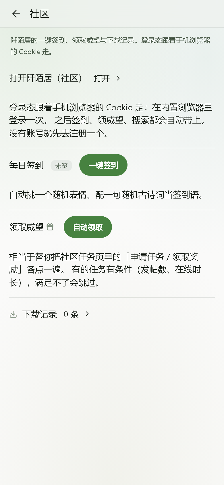
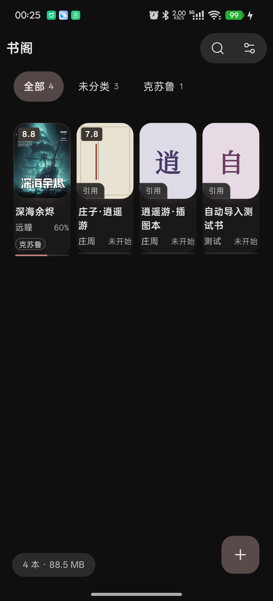
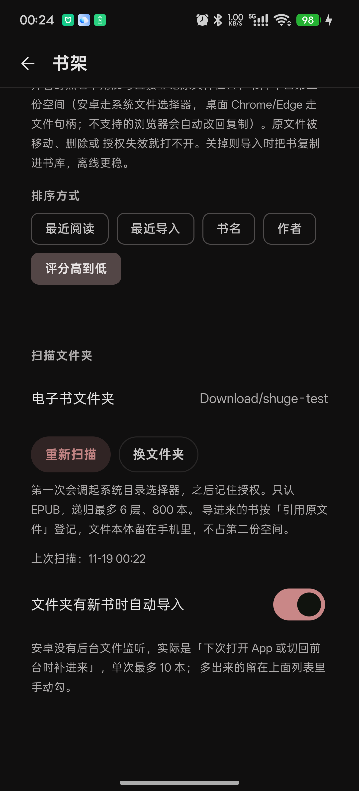
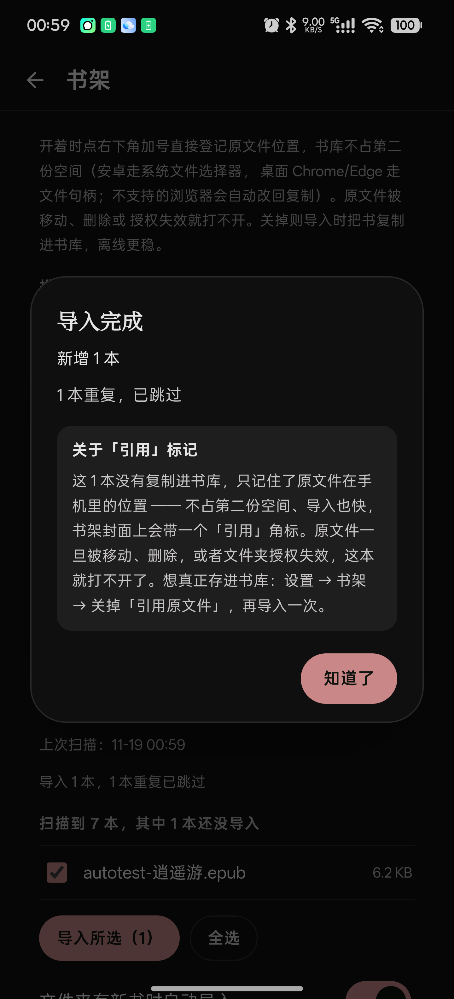
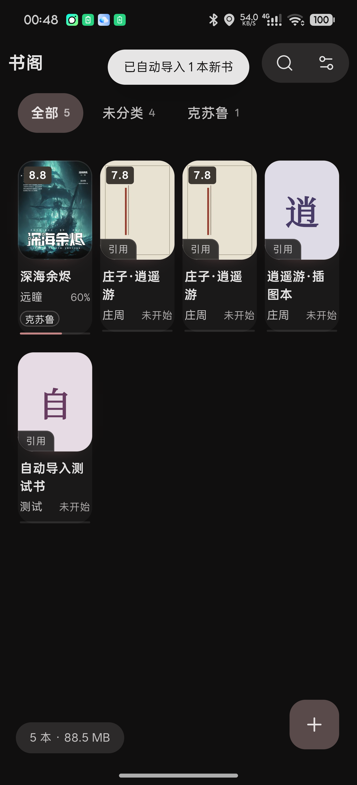

# 书阁 · 本地 EPUB 阅读器

安卓手机上的本地 EPUB 阅读器，PWA，可添加到主屏幕当 App 用，离线可读。书籍文件只存在本机浏览器私有目录，不上传。

做它的原因很实际：手机里攒了几百本网文 EPUB，多半是多看、Z-Library、各种导出工具生成的，导入别的阅读器不是打不开就是插图空白。这里的取舍是**对「脏书」宽容**——OPF 丢了、命名空间写错、manifest 没登记图片、zip 头被清零，都尽量让你读上，而不是弹个「文件损坏」。

| 书架（标签页） | 阅读 | 书架搜索 | 原生外观 | 社区 |
|---|---|---|---|---|
|  |  |  |  |  |

| 真机书架 | 扫描文件夹 | 导入结果弹窗 | 自动导入提示 |
|---|---|---|---|
|  |  |  |  |

## 现在能做什么

- 书架：顶部**标签页**（全部 / 未分类 / 各题材，带本数）；网格 / 列表两种排布，网格每行 2–4 本；最近阅读 / 最近导入 / 书名 / 作者 / 评分 五种排序（入口在设置 02），长按删除、多选批量打标签，删除可进回收站反悔
- **书架搜索**：顶栏搜索钮，范围三选——书架（当前标签页）/ 本地（全库）/ 社区（阡陌居论坛），本地按书名、作者、标签过滤
- **社区（阡陌居）**：内置浏览器登录一次后，可以一键签到（随机表情 + 随机古诗词）、自动申请并领取威望任务、查看下载记录；论坛搜索结果直接在书架搜索里出
- 标签与评分：导入时从书名（`[游戏异界]`）和 `dc:subject` 自动提取标签；导入后在后台自动关联评分站（豆瓣 / 微信读书，默认按评分人数最多挑，也可锁定优先站），长按可查看候选、换站、取消关联或手动打分。只取书名、作者、封面、评分与人数，不抓短评不抓评论
- 界面风格三选：**极简**（纸感细边框）/ **原生**（跟手机系统壁纸取色，按 Material You 生成整套配色）/ **液态玻璃**（磨砂浮层、大圆角，开发中）；明暗跟随系统或手动锁浅色/深色
- 导入：批量选择 EPUB，流式写入 OPFS，采样指纹去重，导入进度与失败原因可见；也可选**引用原文件**（不复制，安卓走 SAF、桌面走 File System Access，原文件挪走会提示重新导入）。每次导入结束弹窗汇总：新增 / 重复 / 失败条数、失败明细，含引用书时顺带解释「引用」角标的含义
- **扫描文件夹**（安卓 App）：设置 → 书架里授权一个手机文件夹，自动递归列出里面的 EPUB（已导入过的自动隐藏），勾选按引用模式导入；打开「有新书时自动导入」后，App 启动 / 切回前台时自动把新书补进来，导完顶部浮条提示「已自动导入 N 本新书」（阅读页不打扰）。安卓没有后台文件监听，做法对齐 readest 的 auto-import；单次自动导入最多 10 本，授权记住后重启不用重选
- 阅读：左右翻页与上下滚动两种模式；点击屏幕左右三分之一翻页，中间呼出浮层；目录是**层级树**（卷可开合、全部收起）；书里的音频视频可以直接播
- 排版：字号 14–30、五档行距、四档边距、**字重 / 字距 / 段距**、宋体/黑体、**可导入自己的字体**（ttf/otf/woff，可只对本书生效）、两端对齐、首行缩进
- 阅读主题：跟随 App / 纸白 / 宣纸 / 护眼 / 夜读
- 书签：按章节去重，CFI + 摘录
- 搜索：书内全文搜索，结果带关键词高亮，点击跳转
- 进度：CFI 精确定位，杀进程重开回到原处
- 同步：WebDAV 同步书目 / 进度 / 书签 / 标签 / 评分，不传书籍文件；内置坚果云 / Nextcloud / 群晖的地址预设，坚果云双端实测通过
- 网文站：长按书籍或阅读器「书评」，跳到微信读书 / 豆瓣 / 番茄 / 起点看评论（应用内不抓取；可整体关闭这个入口）
- 安全：章节文档在解析阶段剥掉可执行脚本并注入 CSP（实测恶意 EPUB 无法再执行脚本、读配置，见 v1.14.1 更新说明）
- 关于：版本号、开源仓库、问题反馈、检查更新（读 GitHub Release，有新版直接给安装包下载）
- 离线：Service Worker 缓存 app shell，新版本提示更新

## 开发

```bash
npm install
npm run dev          # 本地开发
npm run build        # 类型检查 + 构建
npm run start        # 构建并以 preview 方式监听 3000（部署用）
npm run relay        # 启动中继（默认 8787），浏览器里连 WebDAV、查豆瓣评分都要它
node scripts/release.mjs   # 发版：提交 + tag + 推送 + GitHub Release（见 docs/RELEASING.md）
```

**手机上测必须走 HTTPS。** 局域网 `http://IP` 不是 secure context，Service Worker、OPFS、持久化存储全部不可用。用部署出来的分享链接测。

## 目录

```
src/
├── vendor/foliate-js/    渲染引擎（vendor，锁 commit，见 docs/decisions.md）
├── db/                   Dexie：books / progress / bookmarks / groups / fonts
├── storage/              OPFS 读写（worker 流式写入 + 采样指纹）
├── importer/             解析与批量导入队列
├── reader/               adapter / 主题样式 / 字体库 / 阅读页 / 目录 / 排版 / 搜索
├── shelf/                书架、列表与网格、排序分组、标签评分面板、封面缓存
├── meta/                 标签提取（本地）、书名清洗、评分查询（豆瓣 + 微信读书）
├── ui/                   UI 风格副作用（莫奈取色、风格切换）
├── links/                网文站站点表与外链跳转（含内置浏览器层）
├── community/            阡陌居社区客户端（签到 / 威望任务 / 搜索 / 下载记录）
├── sync/                 WebDAV 同步（webdav 传输层 + 合并规则）
├── settings/             应用设置（存储、主题、同步、元数据）与关于页
├── appinfo.ts            仓库地址、爱发电、打赏码等对外信息
├── update.ts             检查更新（读 GitHub Release）
└── settings.ts           阅读与界面设置（localStorage，同步读取避免闪烁）
relay/                    中继：WebDAV 反代 + 评分查询（豆瓣 / 微信读书，浏览器里用）
_samples/                 测试样本放这里
docs/decisions.md         选型、踩坑、对 vendor 的改动
```

## 还没做

- 书籍文件本身的 WebDAV 备份（现在只同步书目、进度、书签）
- 应用内显示书评（不可行，原因见 `docs/novel-sites.md`；除非接各站开放平台的正式 API）

## 文档

- [`CHANGELOG.md`](CHANGELOG.md)：v1.0 到当前的每版改动
- [`docs/decisions.md`](docs/decisions.md)：选型、踩坑、对 vendor 的每一处补丁
- [`docs/RELEASING.md`](docs/RELEASING.md)：发版流程
- [`docs/sync-and-metadata.md`](docs/sync-and-metadata.md)：WebDAV 同步与网文站关联的调研与方案
- [`docs/novel-sites.md`](docs/novel-sites.md)：网文站关联的调研与被否掉的方案

## 兼容性实测

500 本真实书（10–103MB，多看 / Z-Library / 插图典藏 / 全屏版各种来源）全量跑过：490 本正常、6 本无内嵌插图、4 本 zip 头被清零（已兜底可读），累计 758 张插图 0 损坏 0 溢出。缺陷样本与结论见 `docs/decisions.md` 第 13–17 节。

## 许可

MIT，见 [`LICENSE`](LICENSE)。渲染引擎 [foliate-js](https://github.com/johnfactotum/foliate-js) 为 MIT，源码 vendor 在 `src/vendor/foliate-js`，锁定 commit 记在同目录 `COMMIT.txt`。
